# pioneer-1st-code-team07

매매 전략을 NH선물 모의계좌로 운용하고, 같은 전략을 과거 데이터로 백테스트하는 프로그램.
웹 화면에서 실시간 시세·주문·체결 내역과 전략의 매매 이력·성과를 확인.

- [모의매매 및 백테스트 프로그램 요구사항](docs/REQUIREMENTS.md)
- [프론트엔드 기술 스택과 폴더 구조](frontend/README.md)
- [백엔드 기술 스택](backend/README.md)
- [조합 탐색 사용법](backend/README.md#조합-탐색), [검증 보고서 형식](backend/reports/README.md)

> 실거래 전에 반드시 모의 환경(`TRADING_ENV=mock`)에서 충분히 시험. 매매 결과의 책임은 사용자에게 있음.

## 전략 검증 흐름

전략의 파라미터(테스트 기간 포함) 조합을 여러 개 백테스트해 결과를 쌓고, 쌓인 결과로 가장 적절한 조합과 그 근거를 보고서로 정리해 대시보드에서 확인하는 흐름이다. 조합 실행과 보고서 작성은 **로컬 Codex 스킬**이 맡고, 계산과 저장은 코드가 한다. LLM API는 호출하지 않는다.

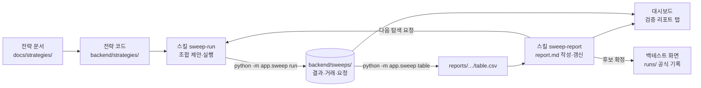

### 단계별 동작과 기록 위치

| 단계 | 하는 일 | 하는 주체 | 생기는 파일 | 커밋 |
|---|---|---|---|---|
| 1. 전략 작성 | 한글 전략 문서를 쓰고 코드로 만든다. 조절할 파라미터와 허용 범위는 `manifest.json`에 둔다 | 사용자, Codex | `docs/strategies/<전략>.md`, `backend/strategies/<전략 id>/` | 예 |
| 2. 조합 제안 | 전략 문서·파라미터·가능 기간·기존 결과를 읽고 조합과 기간 묶음을 제안한다. 사용자가 확인한다 | 스킬 `sweep-run` | `backend/sweeps/<전략 id>/requests/<날짜>-<설명>.json` (요청 파일) | 예 |
| 3. 조합 실행 | 조합마다 백테스트하고 결과를 쌓는다. 같은 정의의 조합은 건너뛴다. 조합 하나는 약 1초 | `python -m app.sweep run` | `backend/sweeps/<전략 id>/results.jsonl` (조합×기간 한 줄: 정의·성과 요약·일별 자산)<br/>`backend/sweeps/<전략 id>/trades/<id>.jsonl` (거래·체결) | 예 |
| 3-1. 분봉 저장 | 받은 분봉을 저장해 다음 실행에서 모자란 구간만 받는다 | `python -m app.sweep run` | `backend/data/minute_cache/` | **아니오** |
| 4. 비교표 | 쌓인 결과로 조합 × 기간 비교표를 만든다 | `python -m app.sweep table` | `backend/reports/<전략 id>/<보고서 이름>/table.csv` | 예 |
| 5. 보고서 | 추천 조합과 근거(기간별 일관성, 이웃 조합 안정성, 비용, 위험, 시도 횟수), 위험과 한계, 다음 탐색 요청을 쓴다. 갱신하면 같은 파일을 덮어쓰고 이전 내용은 Git 이력에 남는다 | 스킬 `sweep-report` | `backend/reports/<전략 id>/<보고서 이름>/report.md` | 예 |
| 6. 반복 | 보고서의 "다음 탐색 제안"(`sweep-request` 블록)으로 2~5단계를 되풀이한다 | 스킬 | 위와 같음 | 예 |
| 7. 확인 | 대시보드 **검증 리포트** 탭에서 보고서를 골라 본문·비교표·그래프·거래를 본다 | 사용자 | 없음(읽기만) | - |
| 8. 후보 확정 | 고른 조합을 백테스트 화면에서 한 번 더 실행해 판단·주문·체결 전체 기록을 남긴다 | 사용자 | `backend/runs/<전략 id>/backtest/<실행 일시>/` | 예 |

### 스킬

스킬은 절차만 담고, 수치 계산과 저장은 명령이 한다. 스킬 파일은 `.agents/skills/<이름>/SKILL.md`이고 이 저장소 안에서만 쓴다.

| 스킬 | 언제 쓰나 | 하는 일 | 하지 않는 일 |
|---|---|---|---|
| `sweep-run` | 파라미터를 바꿔 가며 성과를 비교하거나, 탐색을 이어서 더 돌릴 때 | 가능 기간 확인 → 조합 제안 → 요청 파일 작성 → `--dry-run` → 실행 → 건수·실패 보고. 한 번에 200회(조합×기간)를 넘기지 않는다 | 전략 코드·`manifest.json`·기존 결과 수정, 키 출력, 확인 없는 대규모 탐색 |
| `sweep-report` | 쌓인 결과로 적절한 조합을 근거와 함께 정리하거나, 새 결과를 기존 보고서에 반영할 때 | `table.csv` 생성 → 분석 → `report.md` 작성·갱신(변경 이력 한 줄 추가) → 수치와 `id` 대조 | 수치를 암산·기억으로 쓰기, 결과 파일 수정, 투자 자문 표현 |

Codex에는 이렇게 요청한다.

```text
week03 ZN 전략의 익절·손절 기준을 0.05~1.0으로 바꿔 가며 sweep-run으로 탐색해 줘.
쌓인 결과로 sweep-report 스킬로 보고서를 갱신해 줘.
```

### 직접 실행하는 명령

백엔드 폴더에서 실행한다. 자세한 사용법은 [backend/README.md](backend/README.md#조합-탐색)에 있다.

```bash
uv run python -m app.sweep range <전략 id>
uv run python -m app.sweep run <요청.json> --dry-run
uv run python -m app.sweep run <요청.json>
uv run python -m app.sweep table <전략 id> --name <보고서 이름>
```

### 알아 둘 점

- 봉마다 남는 판단(`decision`)과 주문은 `sweeps/`에 저장하지 않는다. 백테스트 기록 용량의 대부분이라서다. 거래(`trade`)와 체결(`fill`)만 저장한다.
- 구간은 포지션을 비운 채 독립적으로 시작하므로 전체 기간 순손익은 구간 순손익의 합과 다르다.
- 조합이 늘수록 `sweeps/trades/`가 커진다. 전체 기간(약 3개월) 조합 100개에 약 16~19MB다.
- 보고서는 모의 백테스트의 비교 결과이며 투자 판단의 근거가 아니다.

## NH선물 Open API 신청

- 이 프로젝트는 **국내·해외 선물 모의투자 API**를 사용. 해외 종목(예: ZN 국채선물)을 쓸 때만 해외 키 필요.
- 필요한 키: 국내 모의투자 APP Key·APP Secret Key, 해외 전략을 쓰면 해외 모의투자 APP Key·APP Secret Key 추가.

1. NH선물 모의투자 계좌 개설
2. Real HTS의 **[6128] REST API 신청** 화면에서 계좌 선택 후 신청
3. 카카오톡 알림으로 **APP Key**, **APP Secret Key** 확인

- 국내·해외, 모의·실전은 키가 따로 발급됨. 국내 키로는 해외 API를 호출할 수 없음.
- 키는 설정 파일에만 입력. Git·로그·화면에 노출 금지.

## 실행하는 법

백엔드와 프론트엔드를 각각 터미널에서 실행. 터미널 2개 필요.

### 1. 사전 설치

| 도구 | 버전 | 설치(macOS) | 확인 |
|---|---|---|---|
| uv | 최신 | `brew install uv` | `uv --version` |
| Node.js | 22.12 이상 | `brew install node` | `node --version` |

- uv가 Python 3.12 이상을 자동으로 설치.
- Windows·Linux는 [uv](https://docs.astral.sh/uv/getting-started/installation/), [Node.js](https://nodejs.org) 공식 안내 참고.

### 2. 저장소 내려받기

```bash
git clone https://github.com/NH-Futures-Pioneer-1-Team07/pioneer-1st-code-team07.git
cd pioneer-1st-code-team07
```

### 3. 설정 파일 만들기

```bash
cp backend/.env.example backend/.env
```

- `backend/.env`를 열어 신청한 키 입력. 항목은 [설정 파일](#설정-파일) 참고.

```text
TRADING_ENV=mock
NH_APP_KEY=발급받은 APP Key
NH_APP_SECRET=발급받은 APP Secret Key
```

- `NH_APP_KEY`, `NH_APP_SECRET` 앞의 `#`를 지워야 적용.
- 해외 전략을 쓰면 `NH_OVERSEAS_APP_KEY`, `NH_OVERSEAS_APP_SECRET`도 같은 방식으로 입력.

### 4. 백엔드 실행 (터미널 1, 프로젝트 루트에서)

```bash
cd backend
uv sync
uv run uvicorn app.main:create_app --factory --reload
```

- `uv sync`는 처음 한 번만 실행.
- 확인: `http://127.0.0.1:8000/health` 접속 시 응답이 오면 정상.

### 5. 프론트엔드 실행 (터미널 2, 프로젝트 루트에서)

```bash
cd frontend
npm ci
npm run dev
```

- `npm ci`는 처음 한 번만 실행.
- 확인: 브라우저에서 `http://127.0.0.1:5173` 접속.

### 실행이 안 될 때

| 증상 | 해결 |
|---|---|
| `TRADING_ENV` 없음 오류 | `backend/.env` 생성 여부와 `TRADING_ENV` 값 확인 |
| 화면은 뜨는데 시세·주문이 안 됨 | 백엔드 실행 여부와 `NH_APP_KEY`·`NH_APP_SECRET` 확인 |
| 해외 종목 조회·실행이 `503` | `NH_OVERSEAS_APP_KEY`·`NH_OVERSEAS_APP_SECRET` 입력 여부 확인 |
| NH 호출 오류 | 키가 `TRADING_ENV`와 같은 환경(모의/실전)의 키인지 확인 |
| `8000` 포트 사용 중 | 기존 프로세스 종료 후 재실행 |

### 테스트 (프로젝트 루트에서)

```bash
cd backend && uv run pytest
cd frontend && npm test
```

## 프로젝트 구조

```text
pioneer-1st-code-team07/
├── AGENTS.md                         AI 에이전트 작업 지침
├── .agents/skills/                   이 저장소 전용 Codex 스킬
│   ├── sweep-run/SKILL.md            조합 탐색 실행
│   └── sweep-report/SKILL.md         검증 보고서 작성·갱신
├── README.md
├── .github/
│   ├── ISSUE_TEMPLATE/task.md        이슈 양식
│   └── pull_request_template.md      PR 양식
├── backend/                          FastAPI 서버 (Python)
│   ├── pyproject.toml, uv.lock       의존성
│   ├── .env.example                  환경변수 예제
│   ├── app/
│   │   ├── main.py                   앱 생성, 라우터·서비스 연결
│   │   ├── config.py                 환경변수 설정
│   │   ├── data/vix.py               VIX 일 종가 읽기·갱신
│   │   ├── api/                      REST·WebSocket 엔드포인트
│   │   │   ├── health.py             상태 확인
│   │   │   ├── strategies.py         전략 목록·파라미터
│   │   │   ├── trading.py            모의매매 시작·종료·상태
│   │   │   ├── backtests.py          백테스트 실행·가능 기간
│   │   │   ├── runs.py               실행 기록 조회
│   │   │   ├── reports.py            검증 보고서 조회
│   │   │   ├── sweeps.py             조합 결과·거래 조회
│   │   │   ├── market.py             시세·종목 조회
│   │   │   └── stream.py             실시간 시세 WebSocket
│   │   ├── nh/                       NH선물 API 연동
│   │   │   ├── auth.py, client.py    인증·HTTP 호출
│   │   │   ├── rate_limit.py         호출 제한
│   │   │   ├── errors.py, values.py  오류, 응답 값 숫자·날짜 변환
│   │   │   ├── realtime.py, realtime_data.py  실시간 수신·메시지 변환
│   │   │   ├── hub.py                국내·해외 시장별 실시간 연결을 여러 화면이 공유
│   │   │   ├── domestic/             국내 종목
│   │   │   │   ├── quotes.py         분봉·현재가 조회
│   │   │   │   ├── account.py        계좌·잔고 조회
│   │   │   │   ├── orders.py         주문
│   │   │   │   ├── market.py         종목 시세·차트·호가 조회 (화면용)
│   │   │   │   └── market_hours.py   장 종류·운영 시간
│   │   │   └── overseas/             해외 종목 (해외 키 필요)
│   │   │       ├── quotes.py         분봉·일봉·현재가 조회
│   │   │       ├── account.py        계좌·잔고·상품 조회
│   │   │       ├── orders.py         주문
│   │   │       └── market_hours.py   장 종류·운영 시간
│   │   ├── runners/                  전략 실행
│   │   │   ├── backtest.py           백테스트 시뮬레이션
│   │   │   ├── minute_backtest.py    1분봉 가격 경로를 쓰는 백테스트
│   │   │   ├── service.py            백테스트 실행 서비스
│   │   │   ├── inputs.py             전략 입력(추가 봉·VIX·증거금) 준비
│   │   │   ├── series.py             전략이 선언한 일봉 불러오기
│   │   │   ├── overseas.py           해외 종목 실행용 NH 호출 묶음
│   │   │   ├── availability.py       백테스트 가능 기간 계산
│   │   │   ├── paper.py              모의매매 세션 (NH 모의계좌 운용)
│   │   │   ├── paper_service.py      모의매매 실행 서비스
│   │   │   ├── broker.py             모의매매가 쓰는 NH 기능 묶음
│   │   │   ├── ledger.py             포지션·손익 계산 (백테스트·모의매매 공용)
│   │   │   └── clearing.py           계좌 전체 정리
│   │   ├── sweep/                    조합 탐색 (파라미터·기간 조합 백테스트와 결과 누적, 비교표)
│   │   ├── reports/                  검증 보고서 읽기
│   │   └── records/                  실행 기록
│   │       ├── store.py              저장·조회
│   │       ├── events.py             기록 변경을 WebSocket 구독자에 알림
│   │       └── sanitize.py           비밀정보 제거
│   ├── strategy_base/                전략 공통 기반
│   │   ├── interface.py              전략 인터페이스
│   │   ├── models.py                 입력·출력 형식
│   │   ├── manifest.py               전략 폴더 형식
│   │   ├── registry.py               전략 등록
│   │   ├── indicators.py             공통 지표
│   │   └── testing.py                테스트 도우미
│   ├── strategies/                   전략 폴더 (폴더 하나가 전략 하나)
│   │   ├── _template/                새 전략용 템플릿
│   │   └── week03_zn_treasury_futures/  ZN 국채선물 이동평균 전략
│   ├── data/vixcls.csv               VIX 일 종가 데이터
│   ├── data/minute_cache/            조합 탐색이 받아 둔 분봉 (Git에 올리지 않음)
│   ├── runs/                         실행 기록 (README.md에 구조 설명)
│   ├── sweeps/                       조합 탐색 결과 (<전략 id>/results.jsonl, trades/, requests/)
│   ├── reports/                      검증 보고서 (<전략 id>/<이름>/report.md, table.csv. README.md에 형식 설명)
│   └── tests/                        백엔드 테스트
├── frontend/                         React 화면 (TypeScript)
│   ├── package.json, vite.config.ts  의존성·개발 서버·프록시
│   ├── index.html
│   ├── public/licenses/              폰트 등 라이선스
│   └── src/
│       ├── main.tsx, App.tsx         진입점·페이지 전환
│       ├── pages/
│       │   ├── trading/              모의매매 페이지 (PriceChart, JudgmentPanel, RunHistory)
│       │   ├── backtest/             백테스트 페이지 (EquityChart, RecordDetail, CompareSection)
│       │   └── reports/              검증 리포트 페이지 (보고서 목록·본문·비교표)
│       ├── components/common/        공통 컴포넌트 (달력, 탭, 전략 선택, 파라미터 입력, 판단 타임라인 등)
│       ├── apis/                     백엔드 호출 (Axios, 폴링, 시세 WebSocket)
│       ├── data/                     화면용 데이터 변환·서식과 테스트
│       └── styles/                   전역 스타일·색상
└── docs/
    ├── REQUIREMENTS.md               프로그램 요구사항
    ├── GIT_WORKFLOW.md               Git·GitHub 규칙
    ├── strategies/                   전략 문서 (주차별 전략, archive/week02 보관)
    └── nh-api/                       NH선물 API 명세 (API별 문서, 오류코드, 종목 마스터)
```

## 설정 파일

`backend/.env`에 저장. 템플릿은 `backend/.env.example`.

| 변수 | 필수 | 설명 |
|---|---|---|
| `TRADING_ENV` | 필수 | `mock`(모의) 또는 `real`(실전). 모의투자는 `mock` |
| `NH_APP_KEY` | NH 호출 시 | 선택한 환경의 APP Key |
| `NH_APP_SECRET` | NH 호출 시 | 선택한 환경의 APP Secret Key |
| `NH_OVERSEAS_APP_KEY` | 해외 종목 시 | 해외 API용 APP Key |
| `NH_OVERSEAS_APP_SECRET` | 해외 종목 시 | 해외 API용 APP Secret Key |
| `STRATEGIES_DIR` | 선택 | 전략 폴더 위치. 기본 `backend/strategies` |
| `RUNS_DIR` | 선택 | 실행 기록 위치. 기본 `backend/runs` |
| `SWEEPS_DIR` | 선택 | 조합 탐색 결과 위치. 기본 `backend/sweeps` |
| `REPORTS_DIR` | 선택 | 검증 보고서 위치. 기본 `backend/reports` |
| `MINUTE_CACHE_DIR` | 선택 | 조합 탐색이 저장하는 분봉 위치. 기본 `backend/data/minute_cache` |
| `BACKTEST_FEE_RATE` | 선택 | 백테스트 수수료율. 기본 0.0085% |
| `BACKTEST_SLIPPAGE_TICKS` | 선택 | 백테스트 슬리피지 틱 수. 기본 1 |

- `.env`는 커밋 금지.

## 주요 기능

### 모의매매

- 전략 선택, 운용 시작·종료, 익절·손절 기준 입력
- 국내·해외 종목 시세·차트·호가 조회와 실시간 체결·호가 수신(WebSocket)
- 전략 판단 선과 판단 내용(설명 툴팁, 판단 패널) 표시
- 국내·해외 모의계좌의 예탁자산·보유 포지션·미체결 주문·손익 확인
- 계좌 전체 정리(미체결 취소·전체 포지션 청산)

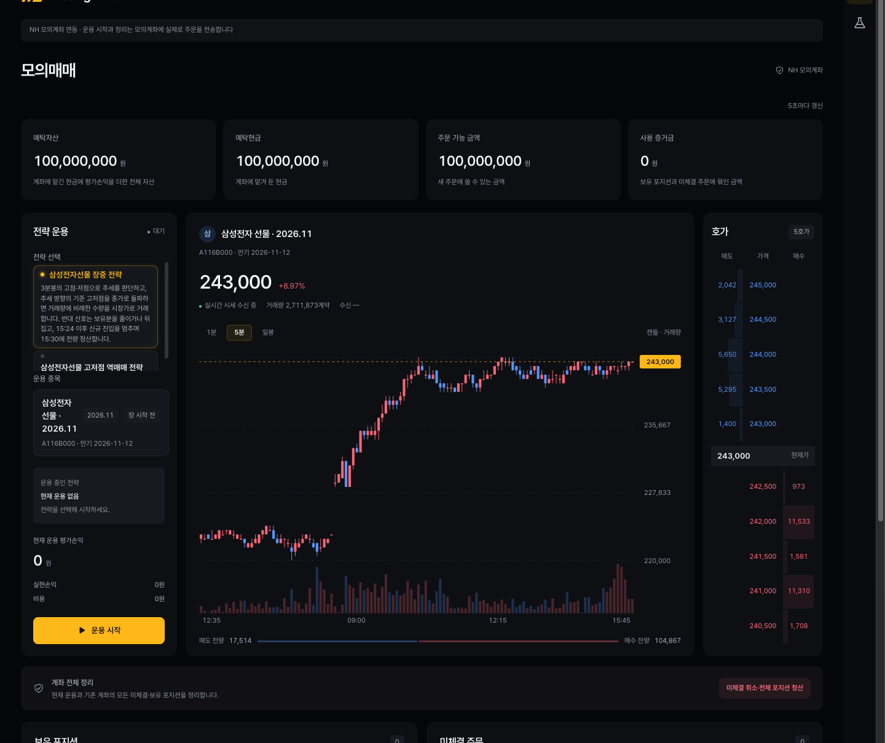

### 백테스트

- 전략·종목·기간·초기자금·슬리피지·익절·손절 기준 설정 후 실행
- 자산 변화 차트, 매매 판단·체결 이력 확인

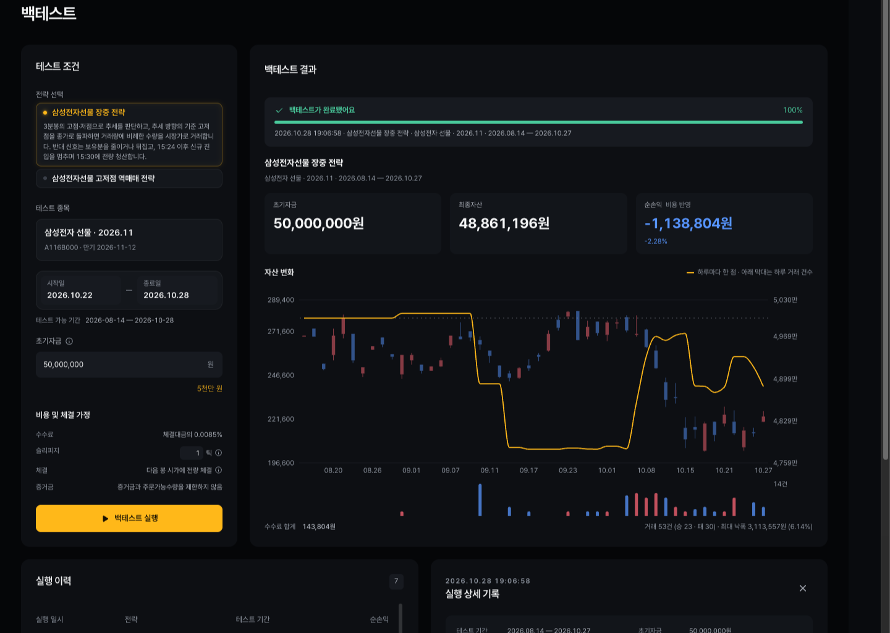

#### 이력 비교

- 실행 이력 아래에서 완료된 이력을 최대 4개 골라 설정과 성과를 비교
- 첫 번째로 고른 이력(A)이 기준이며, 종목·초기자금·테스트 기간이 같은 이력만 선택 가능
- 선택할 수 없는 이력은 흐리게 표시하고 사유 표시
- 전략과 수수료·슬리피지는 달라도 비교 가능
- 수익성·위험·거래·비용·곡선 묶음에서 비교할 수치를 복수 선택하면 수치마다 비교 카드 추가
- 설정값 카드에서 이력 간 값이 다른 파라미터를 강조

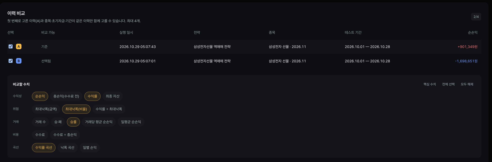

이력 선택(기준 A, 비교 B)과 비교할 수치 선택.

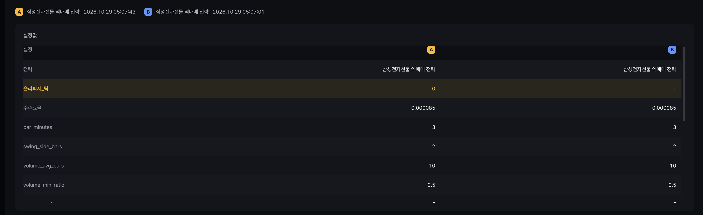

전략 파라미터·슬리피지·수수료율 비교. 다른 값은 강조.

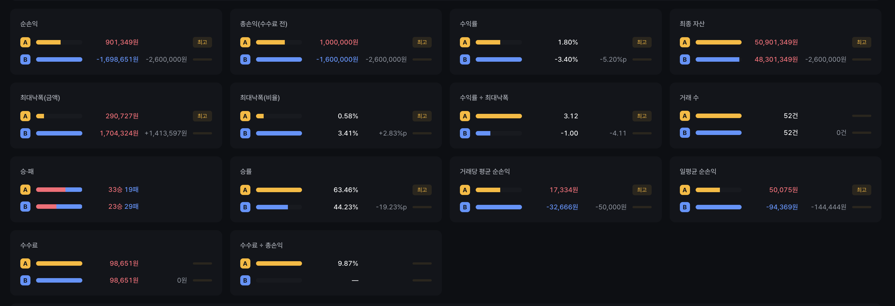

이력별 막대, 기준 대비 증감, 최고값 표시.

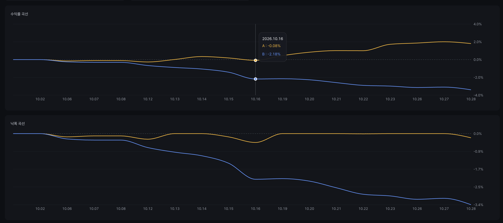

이력별 수익률 곡선과 낙폭 곡선 겹쳐 보기.

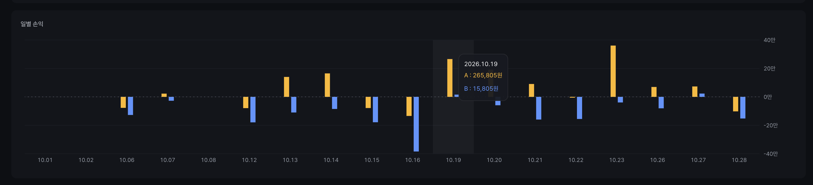

같은 날짜끼리 이력별 일별 손익 나란히 보기.

### 검증 리포트

- 조합 탐색 결과로 쓴 검증 보고서의 목록과 상세를 확인
- 추천·대안 조합 카드, 본문(요약·근거·위험과 한계), 다음 탐색 요청(복사 버튼) 표시
- 파라미터별 성과(바꾼 파라미터를 가로축으로 기간별 선), 기간별 순손익 막대, 추천·대안 조합의 수익률 곡선
- 추천·대안 조합과 기간을 골라 청산 이유별 손익 요약과 거래 목록(진입·청산 시각·가격·손익·이유) 확인
- 비교표에서 보고 싶은 지표를 고르고 열 제목을 눌러 정렬
- 보고서는 `backend/reports/<전략 id>/<이름>/report.md`이며, 파일이 바뀌면 15초 안에 화면이 갱신됨
- 조합 탐색 실행과 보고서 작성은 Codex 스킬(`sweep-run`, `sweep-report`)이 맡고 사용법은 [backend/README.md](backend/README.md)의 조합 탐색에 있음

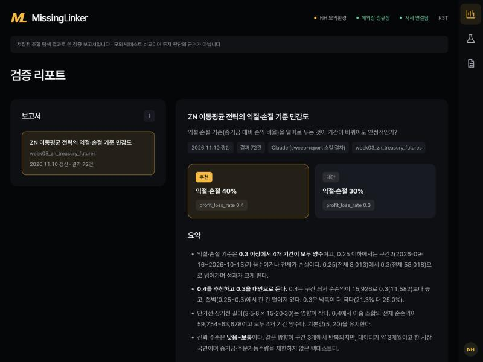

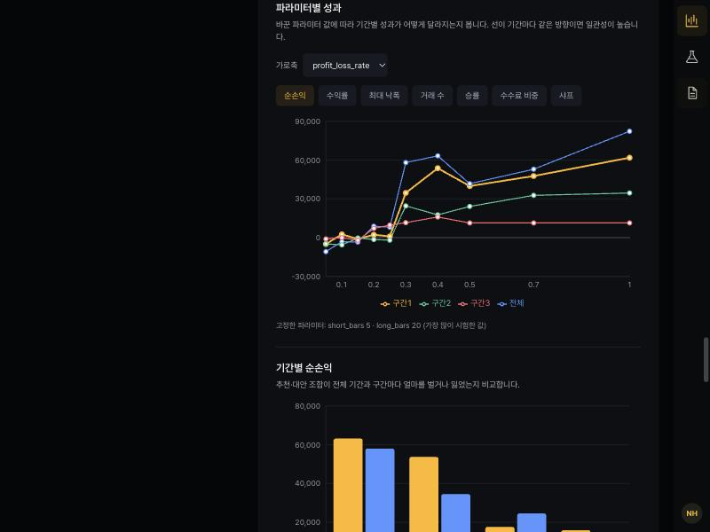

바꾼 파라미터 값에 따른 기간별 성과와 추천·대안 조합의 기간별 순손익.

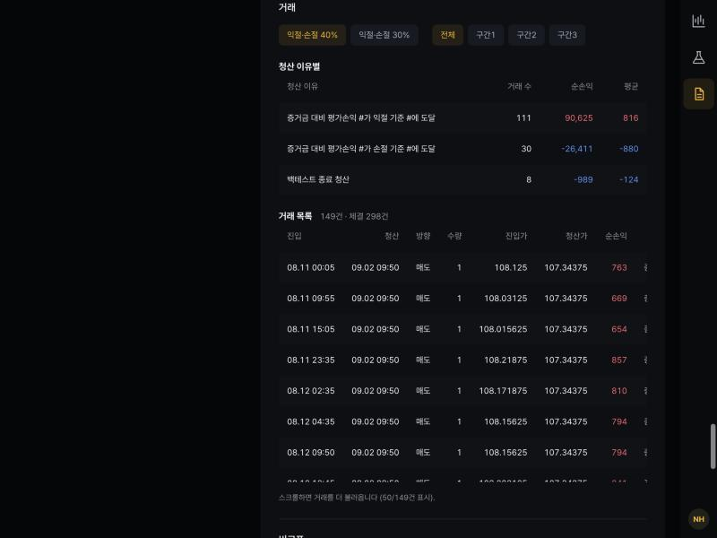

청산 이유별 손익 요약과 거래 목록.

### 공통

- 모의매매·백테스트 실행 기록 저장과 조회, 이력 이름 옆에 사용한 파라미터 표시
- 전략 입력으로 다중 봉(일봉 등)·VIX·증거금 제공
- 두 기능이 같은 전략 판단 코드 공유

## 기술 스택

버전은 `backend/uv.lock`, `frontend/package.json` 기준.

**백엔드**

| 기술 | 버전 | 역할 |
|---|---|---|
| Python | 3.12 | 전략·지표 계산, 백테스트, 서버 구현 |
| uv | 0.13 | Python·가상환경·의존성 관리 |
| FastAPI | 0.162.0 | 화면용 REST API, 실시간 시세 WebSocket 서버 |
| Uvicorn | 0.54.0 | FastAPI 실행 서버 |
| Pydantic Settings | 2.16.1 | `.env` 환경변수 읽기·검증 |
| httpx | 0.28.1 | NH선물 REST API 호출 (인증·시세·주문·계좌) |
| websockets | 17.3 | NH선물 실시간 시세·체결 수신 |
| pytest | 9.2.0 | 백엔드 테스트 |

**프론트엔드**

| 기술 | 버전 | 역할 |
|---|---|---|
| Node.js | 22.12 이상 | 개발 서버·빌드 실행 환경 |
| React | 19.3.1 | 화면 구성 |
| TypeScript | 7.0.2 | 타입 정의와 검사 |
| Vite | 8.3.5 | 개발 서버·빌드 |
| Axios | 1.21.0 | 백엔드 REST API 호출 |
| Recharts | 3.10.1 | 가격·자산 변화 차트 |
| Pretendard | 1.3.9 | 화면 글꼴 |

**외부 API**

| 기술 | 범위 | 역할 |
|---|---|---|
| NH선물 Open API | 국내·해외 모의투자 | 시세 조회, 주문, 계좌 조회, 실시간 체결·호가 수신(국내·해외) |
| FRED `VIXCLS` | VIX 일 종가 | 전략 입력용 VIX (`backend/data/vixcls.csv`에 저장해 사용) |

## 아키텍처

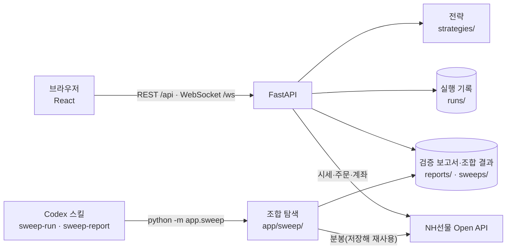

- 모의매매와 백테스트는 같은 전략 코드를 호출.
- 조합 탐색은 서버 없이 같은 백테스트 엔진을 직접 호출하고, 백엔드는 쌓인 결과와 보고서를 읽기만 함.
- 매매 실행은 백엔드가 관리. 프론트엔드는 조회·실행 요청만 수행.
