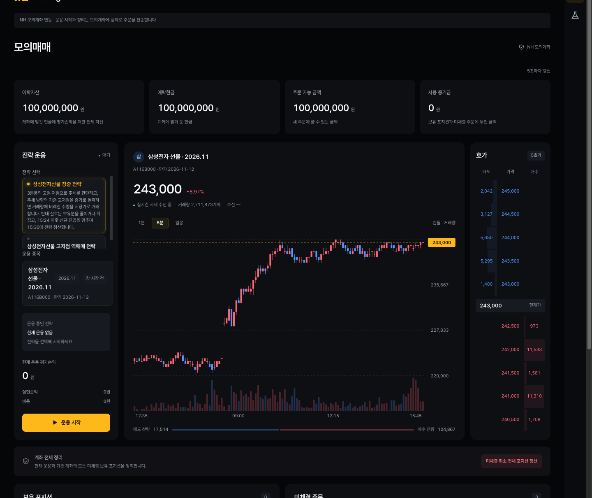
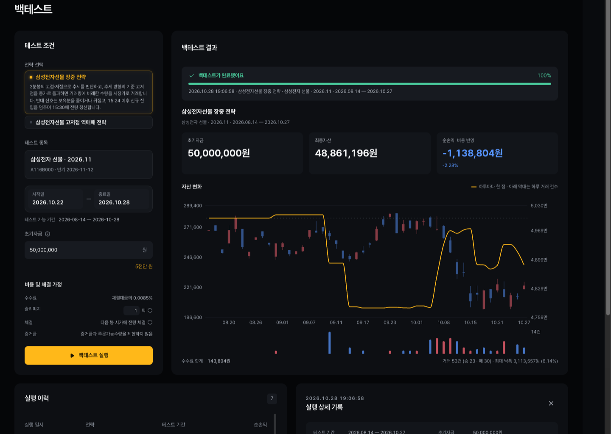
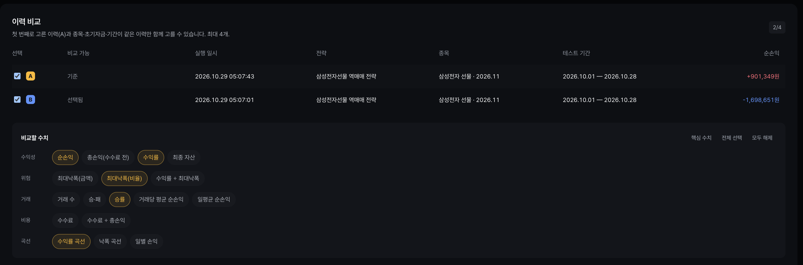
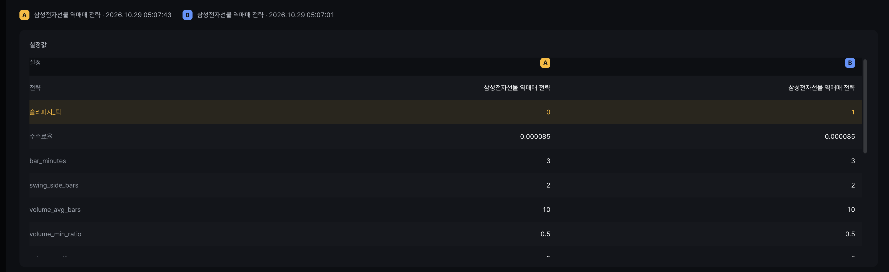
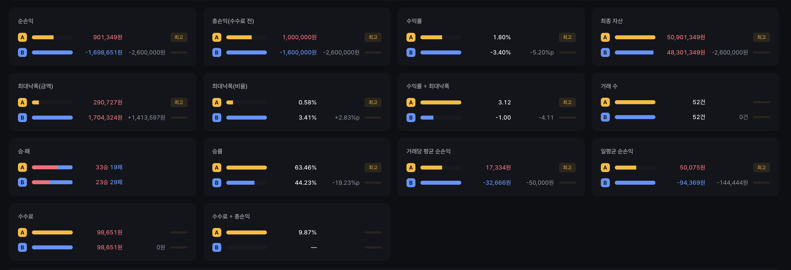
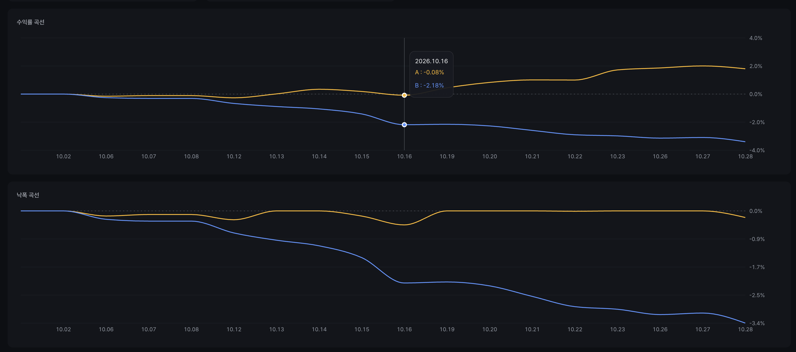
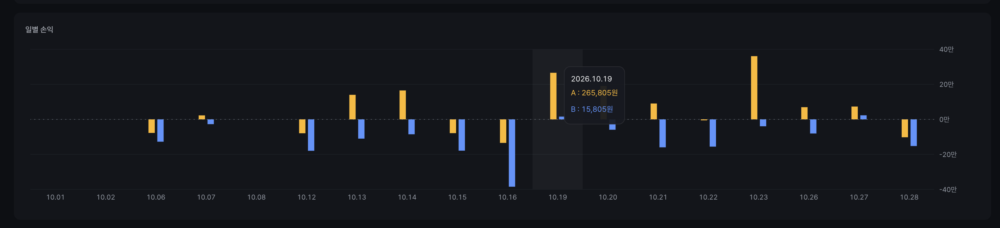
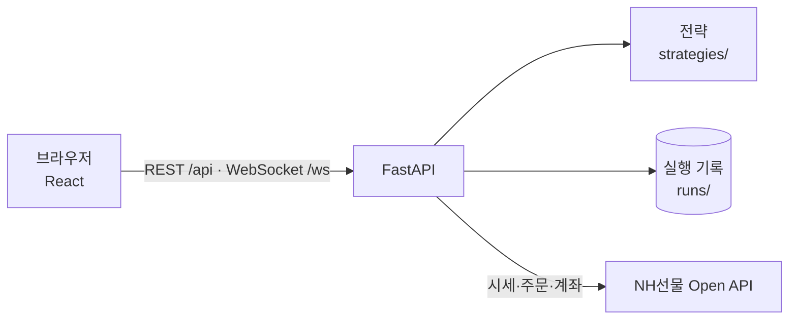

# pioneer-1st-code-team07

매매 전략을 NH선물 모의계좌로 운용하고, 같은 전략을 과거 데이터로 백테스트하는 프로그램.
웹 화면에서 실시간 시세·주문·체결 내역과 전략의 매매 이력·성과를 확인.

- [모의매매 및 백테스트 프로그램 요구사항](docs/REQUIREMENTS.md)
- [프론트엔드 기술 스택과 폴더 구조](frontend/README.md)
- [백엔드 기술 스택](backend/README.md)

> 실거래 전에 반드시 모의 환경(`TRADING_ENV=mock`)에서 충분히 시험. 매매 결과의 책임은 사용자에게 있음.

## NH선물 Open API 신청

- 이 프로젝트는 **국내 선물 모의투자 API** 기준. 해외 API는 사용하지 않음.
- 필요한 키: 국내 모의투자 APP Key·APP Secret Key.

1. NH선물 모의투자 계좌 개설
2. Real HTS의 **[6128] REST API 신청** 화면에서 계좌 선택 후 신청
3. 카카오톡 알림으로 **APP Key**, **APP Secret Key** 확인

- 국내·해외, 모의·실전은 키가 따로 발급됨.
- 키는 설정 파일에만 입력. Git·로그·화면에 노출 금지.

## 실행하는 법

백엔드와 프론트엔드를 각각 터미널에서 실행. 터미널 2개 필요.

### 1. 사전 설치

| 도구 | 버전 | 설치(macOS) | 확인 |
|---|---|---|---|
| uv | 최신 | `brew install uv` | `uv --version` |
| Node.js | 22.12 이상 | `brew install node` | `node --version` |

- uv가 Python 3.12 이상을 자동으로 설치.
- Windows·Linux는 [uv](https://docs.astral.sh/uv/getting-started/installation/), [Node.js](https://nodejs.org) 공식 안내 참고.

### 2. 저장소 내려받기

```bash
git clone https://github.com/NH-Futures-Pioneer-1-Team07/pioneer-1st-code-team07.git
cd pioneer-1st-code-team07
```

### 3. 설정 파일 만들기

```bash
cp backend/.env.example backend/.env
```

- `backend/.env`를 열어 신청한 키 입력. 항목은 [설정 파일](#설정-파일) 참고.

```text
TRADING_ENV=mock
NH_APP_KEY=발급받은 APP Key
NH_APP_SECRET=발급받은 APP Secret Key
```

- `NH_APP_KEY`, `NH_APP_SECRET` 앞의 `#`를 지워야 적용.

### 4. 백엔드 실행 (터미널 1, 프로젝트 루트에서)

```bash
cd backend
uv sync
uv run uvicorn app.main:create_app --factory --reload
```

- `uv sync`는 처음 한 번만 실행.
- 확인: `http://127.0.0.1:8000/health` 접속 시 응답이 오면 정상.

### 5. 프론트엔드 실행 (터미널 2, 프로젝트 루트에서)

```bash
cd frontend
npm ci
npm run dev
```

- `npm ci`는 처음 한 번만 실행.
- 확인: 브라우저에서 `http://127.0.0.1:5173` 접속.

### 실행이 안 될 때

| 증상 | 해결 |
|---|---|
| `TRADING_ENV` 없음 오류 | `backend/.env` 생성 여부와 `TRADING_ENV` 값 확인 |
| 화면은 뜨는데 시세·주문이 안 됨 | 백엔드 실행 여부와 `NH_APP_KEY`·`NH_APP_SECRET` 확인 |
| NH 호출 오류 | 키가 `TRADING_ENV`와 같은 환경(모의/실전)의 키인지 확인 |
| `8000` 포트 사용 중 | 기존 프로세스 종료 후 재실행 |

### 테스트 (프로젝트 루트에서)

```bash
cd backend && uv run pytest
cd frontend && npm test
```

## 프로젝트 구조

```text
pioneer-1st-code-team07/
├── AGENTS.md                         AI 에이전트 작업 지침
├── README.md
├── .github/
│   ├── ISSUE_TEMPLATE/task.md        이슈 양식
│   └── pull_request_template.md      PR 양식
├── backend/                          FastAPI 서버 (Python)
│   ├── pyproject.toml, uv.lock       의존성
│   ├── .env.example                  환경변수 예제
│   ├── app/
│   │   ├── main.py                   앱 생성, 라우터·서비스 연결
│   │   ├── config.py                 환경변수 설정
│   │   ├── api/                      REST·WebSocket 엔드포인트
│   │   │   ├── health.py             상태 확인
│   │   │   ├── strategies.py         전략 목록·파라미터
│   │   │   ├── trading.py            모의매매 시작·종료·상태
│   │   │   ├── backtests.py          백테스트 실행·가능 기간
│   │   │   ├── runs.py               실행 기록 조회
│   │   │   ├── market.py             시세·종목 조회
│   │   │   └── stream.py             실시간 시세 WebSocket
│   │   ├── nh/                       NH선물 API 연동
│   │   │   ├── auth.py, client.py    인증·HTTP 호출
│   │   │   ├── rate_limit.py         호출 제한
│   │   │   ├── errors.py, values.py  오류, 응답 값 숫자·날짜 변환
│   │   │   ├── quotes.py             국내 분봉·현재가 조회
│   │   │   ├── account.py            계좌·잔고 조회
│   │   │   ├── orders.py             주문
│   │   │   ├── realtime.py, realtime_data.py  실시간 수신·메시지 변환
│   │   │   ├── hub.py                실시간 연결 하나를 여러 화면이 공유
│   │   │   ├── market.py             종목 시세·차트·호가 조회 (화면용)
│   │   │   └── market_hours.py       장 종류·운영 시간
│   │   ├── runners/                  전략 실행
│   │   │   ├── backtest.py           백테스트 시뮬레이션
│   │   │   ├── service.py            백테스트 실행 서비스
│   │   │   ├── availability.py       백테스트 가능 기간 계산
│   │   │   ├── paper.py              모의매매 세션 (NH 모의계좌 운용)
│   │   │   ├── paper_service.py      모의매매 실행 서비스
│   │   │   ├── broker.py             모의매매가 쓰는 NH 기능 묶음
│   │   │   ├── ledger.py             포지션·손익 계산 (백테스트·모의매매 공용)
│   │   │   └── clearing.py           계좌 전체 정리
│   │   └── records/                  실행 기록
│   │       ├── store.py              저장·조회
│   │       └── sanitize.py           비밀정보 제거
│   ├── strategy_base/                전략 공통 기반
│   │   ├── interface.py              전략 인터페이스
│   │   ├── models.py                 입력·출력 형식
│   │   ├── manifest.py               전략 폴더 형식
│   │   ├── registry.py               전략 등록
│   │   ├── indicators.py             공통 지표
│   │   └── testing.py                테스트 도우미
│   ├── strategies/                   전략 폴더 (폴더 하나가 전략 하나)
│   │   ├── _template/                새 전략용 템플릿
│   │   ├── week02_samsung_futures_intraday/
│   │   └── week02_samsung_futures_reversal/
│   ├── runs/                         실행 기록 (README.md에 구조 설명)
│   └── tests/                        백엔드 테스트
├── frontend/                         React 화면 (TypeScript)
│   ├── package.json, vite.config.ts  의존성·개발 서버·프록시
│   ├── index.html
│   ├── public/licenses/              폰트 등 라이선스
│   └── src/
│       ├── main.tsx, App.tsx         진입점·페이지 전환
│       ├── pages/
│       │   ├── trading/              모의매매 페이지 (PriceChart, RunHistory)
│       │   └── backtest/             백테스트 페이지 (EquityChart, RecordDetail, CompareSection)
│       ├── components/common/        공통 컴포넌트 (달력, 탭, 전략 선택 등)
│       ├── apis/                     백엔드 호출 (Axios, 폴링, 시세 WebSocket)
│       ├── data/                     화면용 데이터 변환·서식과 테스트
│       └── styles/                   전역 스타일·색상
└── docs/
    ├── REQUIREMENTS.md               프로그램 요구사항
    ├── GIT_WORKFLOW.md               Git·GitHub 규칙
    ├── strategies/                   전략 문서 (작성 가이드, 주차별 전략)
    └── nh-api/                       NH선물 API 명세 (API별 문서, 오류코드, 종목 마스터)
```

## 설정 파일

`backend/.env`에 저장. 템플릿은 `backend/.env.example`.

| 변수 | 필수 | 설명 |
|---|---|---|
| `TRADING_ENV` | 필수 | `mock`(모의) 또는 `real`(실전). 모의투자는 `mock` |
| `NH_APP_KEY` | NH 호출 시 | 선택한 환경의 APP Key |
| `NH_APP_SECRET` | NH 호출 시 | 선택한 환경의 APP Secret Key |
| `STRATEGIES_DIR` | 선택 | 전략 폴더 위치. 기본 `backend/strategies` |
| `RUNS_DIR` | 선택 | 실행 기록 위치. 기본 `backend/runs` |
| `BACKTEST_FEE_RATE` | 선택 | 백테스트 수수료율. 기본 0.0085% |
| `BACKTEST_SLIPPAGE_TICKS` | 선택 | 백테스트 슬리피지 틱 수. 기본 1 |

- `.env`는 커밋 금지.

## 주요 기능

### 모의매매

- 전략 선택, 운용 시작·종료
- 실시간 시세·호가 수신(WebSocket)
- 예탁자산·보유 포지션·미체결 주문·손익 확인
- 계좌 전체 정리(미체결 취소·전체 포지션 청산)



### 백테스트

- 전략·종목·기간·초기자금·슬리피지 설정 후 실행
- 자산 변화 차트, 매매 판단·체결 이력 확인



#### 이력 비교

- 실행 이력 아래에서 완료된 이력을 최대 4개 골라 설정과 성과를 비교
- 첫 번째로 고른 이력(A)이 기준이며, 종목·초기자금·테스트 기간이 같은 이력만 선택 가능
- 선택할 수 없는 이력은 흐리게 표시하고 사유 표시
- 전략과 수수료·슬리피지는 달라도 비교 가능
- 수익성·위험·거래·비용·곡선 묶음에서 비교할 수치를 복수 선택하면 수치마다 비교 카드 추가
- 설정값 카드에서 이력 간 값이 다른 파라미터를 강조

| 화면 | 설명 |
|---|---|
|  | 이력 선택(기준 A, 비교 B)과 비교할 수치 선택 |
|  | 전략 파라미터·슬리피지·수수료율 비교. 다른 값은 강조 |
|  | 이력별 막대, 기준 대비 증감, 최고값 표시 |
|  | 이력별 수익률 곡선과 낙폭 곡선 겹쳐 보기 |
|  | 같은 날짜끼리 이력별 일별 손익 나란히 보기 |

### 공통

- 모의매매·백테스트 실행 기록 저장과 조회
- 두 기능이 같은 전략 판단 코드 공유

## 기술 스택

버전은 `backend/uv.lock`, `frontend/package.json` 기준.

**백엔드**

| 기술 | 버전 | 역할 |
|---|---|---|
| Python | 3.12 | 전략·지표 계산, 백테스트, 서버 구현 |
| uv | 0.13 | Python·가상환경·의존성 관리 |
| FastAPI | 0.162.0 | 화면용 REST API, 실시간 시세 WebSocket 서버 |
| Uvicorn | 0.54.0 | FastAPI 실행 서버 |
| Pydantic Settings | 2.16.1 | `.env` 환경변수 읽기·검증 |
| httpx | 0.28.1 | NH선물 REST API 호출 (인증·시세·주문·계좌) |
| websockets | 17.3 | NH선물 실시간 시세·체결 수신 |
| pytest | 9.2.0 | 백엔드 테스트 |

**프론트엔드**

| 기술 | 버전 | 역할 |
|---|---|---|
| Node.js | 22.12 이상 | 개발 서버·빌드 실행 환경 |
| React | 19.3.1 | 화면 구성 |
| TypeScript | 7.0.2 | 타입 정의와 검사 |
| Vite | 8.3.5 | 개발 서버·빌드 |
| Axios | 1.21.0 | 백엔드 REST API 호출 |
| Recharts | 3.10.1 | 가격·자산 변화 차트 |
| Pretendard | 1.3.9 | 화면 글꼴 |

**외부 API**

| 기술 | 범위 | 역할 |
|---|---|---|
| NH선물 Open API | 국내 모의투자 | 시세 조회, 주문, 계좌 조회, 실시간 체결·호가 수신 |

## 아키텍처



- 모의매매와 백테스트는 같은 전략 코드를 호출.
- 매매 실행은 백엔드가 관리. 프론트엔드는 조회·실행 요청만 수행.
